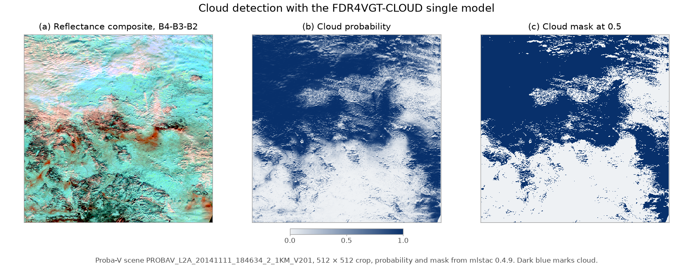

# FDR4VGT-CLOUD

Cloud detection for Proba-V and SPOT-VGT imagery.

This repository contains the code, model definitions, training scripts, evaluation tools, and split metadata for the FDR4VGT-CLOUD release. Raw reflectance rasters, human-annotated masks, and point validation data are **not included** in this repository.

## What is included

- `src/fdr4vgt_cloud/` -- model, inference, metrics, COG helpers, training code.
- `pipeline/` -- numbered scripts that reproduce the release from source data.
- `splits/` -- train/val/test assignments for the 117 pixel scenes and 49 point scenes.
- `configs/` -- seeds, model definitions and training hyperparameters.
- `notebooks/01_quickstart.ipynb` -- getting-started notebook.
- `hf_model/` -- placeholder structure for the Hugging Face model repository.

## What is **not** included

- Proba-V/SPOT-VGT reflectance images (download from [Terrascope](https://terrascope.be) or VITO with their own terms).
- Human-annotated pixel masks from the ESA Phi-lab Round Robin exercise.
- Point validation data from Brockmann Consult Proba-V-C2-CloudValidation.
- Model weights and TACO archives (built locally with the pipeline scripts).

## Quick start

Install the inference dependencies:

```bash
pip install mlstac==0.4.9 rasterio "torch>=2.7.0" "segmentation-models-pytorch>=0.5.0"
```

Run inference on the public Proba-V sample hosted on Hugging Face:

```python
import mlstac
from huggingface_hub import hf_hub_download
import rasterio as rio
import torch

# Load the single model from Hugging Face.
loader = mlstac.load(
    "https://huggingface.co/isp-uv-es/FDR4VGT-CLOUD/resolve/main/single/multisensor_single_1dpwdeeplabv3.json"
)
downloaded = loader.download(output_dir="fdr4vgt_model")
model = downloaded.compiled_model(device="cpu")

# Download the sample GeoTIFF (4 bands, EPSG:4326).
sample_path = hf_hub_download(
    repo_id="isp-uv-es/ProbaV-SPOT",
    filename="PROBAV_L2A_20141111_184634_2_1KM_V201.tif",
    repo_type="dataset",
)

# Read a 512x512 crop and predict.
# Proba-V L2A radiometry stores bands as RED, NIR, BLUE, SWIR;
# reorder to the model input Blue, Red, NIR, SWIR.
with rio.open(sample_path) as src:
    image = src.read(window=rio.windows.Window(768, 1536, 512, 512))
image = image[[2, 0, 1, 3]]

image_t = torch.from_numpy(image).float().unsqueeze(0)
with torch.no_grad():
    prob = model(image_t)

print(prob.shape)  # (1, 1, 512, 512)
```

For a step-by-step version see:

- Notebook: [`notebooks/01_quickstart.ipynb`](notebooks/01_quickstart.ipynb)
- Run in Colab: [](https://colab.research.google.com/github/IPL-UV/fdr4vgt-cloud/blob/main/notebooks/01_quickstart.ipynb)



## Model

The operational model is `CombinedNet4`: a DeepLabV3 encoder (MobileNetV2, no pretrained weights) plus a pixel-wise 1x1 MLP and a final 1x1 fusion. The published artifacts wrap logits with a sigmoid so the output is a cloud probability.

The recommended threshold is **0.5**.

## Data provenance and licenses

| Item | License / terms |
|---|---|
| Code in this repository | MIT |
| Splits and metadata (`splits/`, `docs/`) | CC-BY-4.0 |
| Proba-V L2A images | ESA / VITO -- [Terrascope](https://terrascope.be) terms and Copernicus data policy |
| SPOT-VGT images | CNES / VITO / ESA -- [Terrascope](https://terrascope.be) terms and Copernicus data policy |
| Human pixel masks | ESA Phi-lab Round Robin exercise -- not redistributed here |
| Point validation set | Brockmann Consult Proba-V-C2-CloudValidation -- not redistributed here |
| Model weights and TACO archives | Built locally; not hosted in this repository |

Images, masks, and point labels are **not CC-BY**. Obtain them directly from the original providers.

## Reproducing the release

Run the pipeline modules in order:

```bash
pipeline/10_inventory.py
pipeline/11_splits.py
pipeline/12_metadata.py
pipeline/20_cog.py
pipeline/21_verify_cog.py
pipeline/30_build_taco.py
pipeline/31_fix_tacocat_order.py
pipeline/32_docs.py
pipeline/33_verify_taco.py
pipeline/40_export_pt2.py
pipeline/41_verify_pt2.py
pipeline/42_update_mlm_json.py
pipeline/43_check_pretrain_split.py
```

Publication steps (50-52) are run manually after the G0 gates are approved.

## Citation

See `CITATION.cff`.

## Acknowledgements

Developed at IPL-UV with support from the ESA FDR4VGT project and PID2023-148485OB-C21. IRIS was used for interactive mask refinement.
